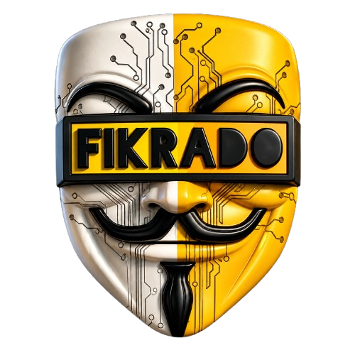

# Fikrado Security · Enterprise Windows Threat Defense Platform

<div align="center">



# FIKRADO SECURITY
### Next-Generation Native Windows Endpoint Defense & Threat Intelligence Platform

[](https://microsoft.com/windows)
[](https://github.com/fikrado2/fikrado-security/releases)
[](https://www.rust-lang.org)
[](https://learn.microsoft.com/en-us/windows/win32/)
[](https://csrc.nist.gov/)
[](LICENSE)

<br/>

**[Website](https://fikrado2.github.io)** • **[Download Installer](https://github.com/fikrado2/fikrado-security/releases/latest)** • **[Documentation](https://fikrado2.github.io)** • **[Author LinkedIn](https://www.linkedin.com/in/yahye-abdirahman/)** • **[Organization](https://github.com/fikrado-orgnasation/)**

</div>

---

## 🛡️ Overview

**Fikrado Security** is a native Windows desktop cybersecurity platform completely engineered in **Rust**. Built for enterprise workstations, security administrators, and power users, it replaces bloated web-wrapped frameworks with a lightning-fast, high-efficiency native binary running with standard Windows 11 hardware-accelerated DWM rendering.

Featuring a high-tech **Cyberpunk Gold & Electric Cyan** Dark Theme alongside a crisp **Frosted Glass Light Theme**, Fikrado Security combines military-grade threat neutralization with an intuitive, modern user experience matching official design mockups.

---

## ✨ Key Features & Capabilities

### 🎨 1. Dual-Theme Visual Experience
* **Cyberpunk Gold & Cyan Theme:** Dark circuit board backdrop (`#080C14`), glowing golden accents (`#FFC700`), and electric cyan highlights (`#00D2FF`).
* **Frosted Glass Light Theme:** Modern high-contrast translucent styling (`#F8FAFC` / `#EAB308` / `#0284C7`) matching official product mockups.
* **Top Theme Toggle:** Seamless one-click switching between dark and light themes with instant persistent theme memory via `SafeStorage`.
* **Translucent Frosted Glass Sidebar:** Genuine `backdrop-filter: blur(25px)` effect with the iconic golden mask logo, glowing divider, and 10 dedicated navigation items.
* **Zero-Trust Login Screen:** Startup workstation authentication supporting PIN verification, Windows Hello biometric bypass, and session remember options.

### 📊 2. Live Kernel Telemetry & Analytics Dashboard
* **Real-Time Hardware Telemetry:** Live CPU load percentage and physical RAM consumption queried directly from the Windows kernel.
* **Total Activity for 7D:** Golden spline area wave chart with gradient illumination and responsive time-range toggling (7D, 14D, 30D).
* **Daily Activities Donut:** Circular activity breakdown with categorized status counters (Safe, Blocked, Scanned, Other).
* **Threat Map:** Global threat vector visualization with geographic distribution telemetry (Blocked, Warned, Allowed).
* **Heuristics Core:** Neon compliance gauges for Memory, File System, Network Sockets, and Behavioral Telemetry.

### 📄 3. Executive Security Audit & Vector PDF Generator
* **One-Click Audit Reports:** Aggregates endpoint health, Microsoft Defender antivirus status, 3/3 Windows Firewall profiles, open network listening sockets, and CISA KEV vulnerability audit data.
* **Presentation-Ready Vector PDF:** Generates a complete executive PDF document saved directly to your desktop (`%USERPROFILE%\Desktop\Fikrado_Security_Audit_Report.pdf`) and automatically launched in the default PDF viewer.

### 🧰 4. 10-Tool Security Control Hub
1. **Microsoft Defender Governance:** Query real-time protection, trigger background quick sweeps, and force antivirus definition updates.
2. **Windows Firewall Management:** Inspect and configure Domain, Private, and Public profiles with one-click "Enable All Profiles".
3. **Automated System Hardening:** Audit and remediate UAC policies, Defender settings, SMBv1 vulnerabilities, and Remote Desktop (RDP) exposure.
4. **Startup Persistence Manager:** Detect and remove stealthy persistence hooks across `Run` and `RunOnce` registry hives.
5. **Real-Time Process Explorer:** Monitor active process memory, CPU utilization, and detect disguised executables (e.g. rogue `svchost.exe` outside System32).
6. **DNS & Network Diagnostics:** Inspect adapter configurations, gateway routing, DNS servers, public IP geolocation, and flush DNS resolver caches.
7. **DoD 5220.22-M File Shredder:** Military-grade sanitization supporting 3-pass and 7-pass random overwrite patterns to render deleted files permanently unrecoverable.
8. **Hosts File Tamper Guard:** Detect unauthorized domain hijacking in Windows `hosts` and restore default clean system configuration.
9. **Password Strength & HIBP Checker:** Shannon entropy analysis paired with SHA-1 k-anonymity breach querying (100% zero password disclosure).
10. **Removable Media & USB Immunizer:** Prevent auto-execution malware attacks on external USB storage drives.

---

## 📦 Distribution Deliverables

| Deliverable | File | Size | Description |
| :--- | :--- | :--- | :--- |
| **Windows Setup Installer** | `FikradoSecuritySetup.exe` | ~5.7 MB | Self-contained installer that registers in Windows Settings and creates Desktop and Start Menu shortcuts. |
| **Portable Application** | `FikradoSecurity.exe` | ~4.8 MB | Single standalone native executable requiring no installation or external runtimes. |
| **Uninstaller** | `FikradoSecurityUninstall.exe` | ~357 KB | Clean uninstaller that removes shortcuts, registry keys, and installation directories. |
| **Icon File** | `logo.ico` | ~132 KB | High-resolution multi-layer Windows application icon. |

---

## 🚀 Installation & Quick Start

### Option A: Install via Windows Setup Installer (Recommended)
1. Download **`FikradoSecuritySetup.exe`** from the [Latest Release](https://github.com/fikrado2/fikrado-security/releases/latest).
2. Run the installer and click **Yes** to proceed.
3. The installer will automatically:
   - Deploy files to `%LOCALAPPDATA%\Programs\Fikrado Security`
   - Create a desktop shortcut (`Fikrado Security.lnk`)
   - Create a Start Menu shortcut
   - Register in Windows Settings (*Apps > Installed Apps*)
4. Launch directly from your desktop or Start Menu!

### Option B: Portable Standalone Executable
1. Download **`FikradoSecurity.exe`** from the [Latest Release](https://github.com/fikrado2/fikrado-security/releases/latest).
2. Double-click **`FikradoSecurity.exe`** to run instantly without installation.

---

## 🛠️ Building from Source

### Prerequisites
* Windows 11 or Windows 10 (64-bit)
* [Rust](https://rustup.rs/) (stable toolchain with `x86_64-pc-windows-msvc`)
* Microsoft Visual Studio C++ Build Tools (MSVC)
* Microsoft Edge WebView2 Runtime (installed by default on Windows 10/11)

### Build Commands

```powershell
# Clone the repository
git clone https://github.com/fikrado2/fikrado-security.git
cd fikrado-security

# One-Click Release Build Script
.\build.bat
```

Or manually with Cargo:
```powershell
# Step 1: Build the main application and uninstaller in release mode
cargo build --release --bin FikradoSecurity --bin FikradoSecurityUninstall

# Step 2: Copy compiled binaries into dist folder
Copy-Item target\release\FikradoSecurity.exe dist\ -Force
Copy-Item target\release\FikradoSecurityUninstall.exe dist\ -Force

# Step 3: Build the self-contained installer (embeds the compiled app)
cargo build --release --bin FikradoSecuritySetup
Copy-Item target\release\FikradoSecuritySetup.exe dist\ -Force
```

---

## 🔒 Security & Cryptographic Architecture

* **Windows DPAPI (Data Protection API):** Sensitive user credentials and AI provider keys are encrypted with user-scope machine master keys (`CryptProtectData`).
* **AES-256-GCM Vault:** Quarantined suspicious artifacts are isolated and encrypted with 256-bit AES authenticated Galois/Counter Mode to prevent secondary execution.
* **DoD 5220.22-M Compliance:** Digital shredder uses cryptographic pseudo-random overwriting compliant with National Industrial Security Program standards.
* **SafeStorage Resilience:** UI state persistence employs protected memory fallback mechanisms that prevent `DOMException` security denials on sandboxed origins.

---

## 👥 Authors & Credits

* **Lead Architect & Developer:** [Yahye Abdirahman](https://www.linkedin.com/in/yahye-abdirahman/)
* **Organization:** [Fikrado Security](https://fikrado2.github.io)
* **Official Repository:** [fikrado2/fikrado-security](https://github.com/fikrado2/fikrado-security)

---

## 📄 License

This project is licensed under the [MIT License](LICENSE).
