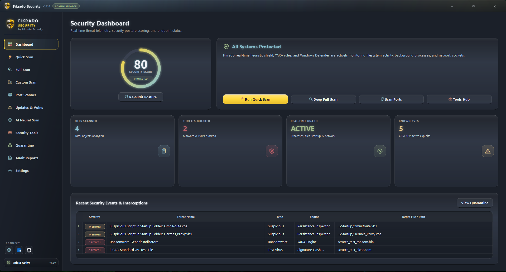
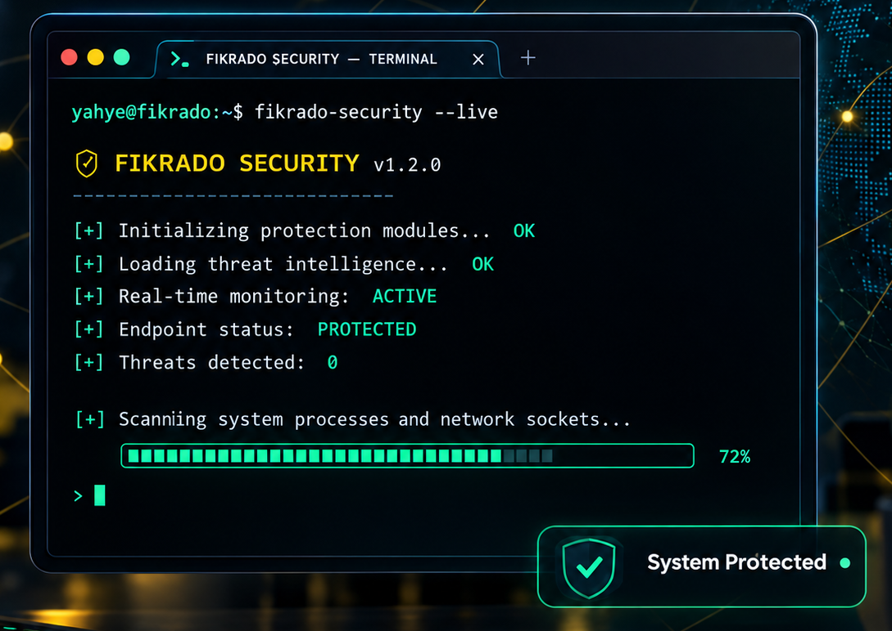

# Fikrado Security - Enterprise Windows Threat Defense Platform

[](https://microsoft.com/windows)
[](https://github.com/fikrado2/fikrado-security/releases)
[](https://python.org)
[](https://qt.io)
[](LICENSE)

**Fikrado Security** is a standalone, next-generation Windows desktop cybersecurity and threat defense platform. Packaged as a double-click executable (`FikradoSecurity.exe`), it requires zero Python runtime dependencies and automatically requests Administrator elevation via an embedded UAC manifest.

**Publisher:** Fikrado Security · **Website:** [fikrado2.github.io](https://fikrado2.github.io) · **LinkedIn:** [Yahye Abdirahman](https://www.linkedin.com/in/yahye-abdirahman/) · **GitHub:** [fikrado-orgnasation](https://github.com/fikrado-orgnasation/)

### What's New in 2.6.87
- **Instant page switching:** pages are created on first visit instead of all at startup, and the expensive whole-page fade effect was removed.
- **Visible loading feedback:** a glass spinner overlay appears while a page is prepared and while background security data is being collected.
- **Non-blocking security audits:** Defender, firewall, startup, process, browser, hardening and DNS queries now run off the UI thread and are cached, so the interface never freezes.
- **Faster startup and rendering:** icon rendering is cached, global text-glow traversal was removed, and the dashboard reuses its last audit result.
- **Stable release line:** this build is pinned at **2.6.87** and keeps that version number for subsequent fixes.
- **Glass + 3D interface:** layered translucent surfaces, gradient highlights, soft depth and a painted ambient backdrop across every page.
- **Colored vector icons:** 59 hand-tuned SVG icons replace every emoji in the interface, with semantic colors for safe, warning, high and critical states.
- **Wider real-time shield:** watches user folders, startup persistence, new network listeners, removable drives and optional full drive roots — not just Downloads and Temp.
- **Native Windows behavior:** rounded DWM window chrome, system tray presence, close-to-tray protection, and a live shield status pill.
- **Silent background execution:** every PowerShell, netsh, winget, Defender and scanner command runs through a hidden-subprocess helper, so no console windows ever flash on screen.
- **Release metadata:** embedded publisher, product name, icon and version information (`2.6.87.0`) in the Windows executable.

---

## 📥 Download

**Cross-Platform — Windows · Linux · macOS**

Grab the latest prebuilt binary from the [Releases page](https://github.com/fikrado2/fikrado-security/releases/latest):

- **Windows:** `FikradoSecurity.exe` → Double-click and accept the UAC elevation prompt.
- **Linux:** `Fikrado-Security.AppImage` → `chmod +x Fikrado-Security.AppImage && ./Fikrado-Security.AppImage`
- **macOS:** `Fikrado-Security.dmg` → Open the DMG, drag to Applications, then **right-click → Open** (first launch only; Apple Gatekeeper requires it for unsigned apps).

> **Note:** All executables are unsigned by default. Windows SmartScreen / macOS Gatekeeper may show a warning. Verify the SHA-256 checksum published with each release if you want to confirm the download.

---

## 🎨 Branding & User Interface Design
- **Dark Nord Theme:** Styled using a custom Qt QSS stylesheet (`assets/styles/theme.qss`) based on the Arctic Nord palette:
  - Backgrounds: `#242933` (deep), `#2E3440` (Nord0 main), `#3B4252` (Nord1 cards), `#434C5E` (Nord2 hover)
  - Typography: `#ECEFF4` (Nord6), `#D8DEE9` (Nord4)
  - Frost & Aurora accents: `#88C0D0` (Frost Cyan), `#A3BE8C` (Green), `#EBCB8B` (Yellow), `#D08770` (Orange), `#BF616A` (Red)
- **Signature Brand Gradient:** Seamless transition from warm golden yellow (`#FFD93D`) to crisp frost cyan (`#88C0D0`), applied to primary action buttons, progress bars, active navigation states, and the logo glow effect.
- **Embedded Visuals:** High-resolution branding bundled directly from `assets/logo.png` and multi-resolution `assets/logo.ico` (256×256 down to 16×16) for the title bar, taskbar, splash screen, and Windows binary icon.
- **Micro-Interactions:** Custom frameless draggable title bar, smooth hover animations, floating non-blocking toast notifications (`ui/components/toast.py`), and an animated circular security posture gauge (`ui/components/circular_gauge.py`).

---

## 🖼️ Screenshots

### Desktop Application Interface


### Command-Line / Terminal View


---

## 🛡️ Core Features & Modular Architecture

```
fikrado-security/
│   main.py                   # Application entrypoint & Qt bootstrap
│   build.bat                 # One-click Windows build script
│   requirements.txt          # Production dependencies
│   FikradoSecurity.spec      # PyInstaller build specification with UAC admin
│   README.md                 # Complete documentation & user guide
│
├── assets/                   # Bundled brand assets (logo.png, logo.ico, SVG icons, QSS)
├── config/                   # Constants, security rules, settings manager (%APPDATA%)
├── core/                     # Logging, DPAPI crypto, SQLite database, quarantine vault, reporting
├── scanners/                 # Malware scanner, YARA engine, PE analyzer, Network/Port, Vuln scanner
├── plugins/                  # Dynamic AI intelligence plugins (Gemini, OpenAI, Claude, Ollama, etc.)
├── tools/                    # Security tools hub (Real-time guard, Firewall, Startup, Shredder, etc.)
└── ui/                       # Modern PySide6 UI (Title bar, circular gauge, toast, 11 pages)
```

---

## 📑 Detailed Page Breakdown (11 Pages)

### 1. Security Dashboard
- Animated circular security posture score (0–100) reflecting system hardening.
- Live KPI metric cards: Scanned Files, Active Protections, Threats Blocked, Known CVEs Tracked.
- Recent security threat activity log with color-coded severity badges.
- One-click navigation to Quick Scan, Full Scan, Port Scanner, and Tools Hub.

### 2. Quick Malware Scan
- High-speed targeted sweep of high-risk locations: running process binaries, Temp directories, Downloads, Desktop, and Startup hooks.
- Real-time file path display, percentage progress bar, and ETA calculation.
- Live findings table with one-click Quarantine, Whitelist, and AI Explain actions.

### 3. Full Drive Scan
- Comprehensive deep inspection across all mounted local Windows drives (`C:\`, `D:\`, etc.).
- Multi-engine analysis with pause/resume and graceful cancellation.

### 4. Custom Path Scan
- Inspect individual suspicious executables, download archives, folders, or external USB storage drives.

### 5. Open Port & Network Scanner
- Scans and visualizes all active listening TCP/UDP sockets mapped to owning processes and PIDs.
- Plain-language risk descriptions for dangerous ports (e.g. 21 FTP, 23 Telnet, 135 RPC, 445 SMB, 3389 RDP, 5900 VNC).
- One-click actions: **Kill Offending Process** or **Add Inbound Windows Firewall Block Rule** via `netsh`.
- Authorized remote IP / subnet scanner with compliance consent verification.

### 6. Known & Emerging Vulnerability Check
- Evaluates installed software inventory against the official **CISA Known Exploited Vulnerabilities (KEV)** catalog.
- Identifies outdated applications and provides one-click background upgrades via `winget`.
- Windows hotfix KB patch level audit.
- Transparent and honest labeling acknowledging 0-day realities.

### 7. AI Threat Intelligence & Neural Scan
- Modular plugin system with built-in support for:
  - **Google Gemini** (Gemini 2.5 Flash)
  - **OpenAI** (GPT-4o / GPT-4o-mini)
  - **Anthropic Claude** (Claude 3.5 Sonnet)
  - **OpenRouter** (Unified multi-model gateway)
  - **Ollama** (100% private, on-device local LLM execution)
  - **Custom OpenAI-Compatible Endpoint** (LM Studio, vLLM, Groq, Mistral)
- **Features:** Explain detected threats in plain English, reverse-engineer obfuscated scripts/macros, audit listening ports & persistence entries, and generate prioritized CISO remediation roadmaps.
- **Privacy First:** Explicit consent modal displays the exact snippet/metadata before any cloud transmission.

### 8. All-In-One Security Tools Hub
Integrates 10 dedicated system utilities:
1. **Real-Time Protection Shield:** Continuous monitoring of user folders, startup persistence, new network listeners, removable drives, and optional full drive roots, plus real-time process execution monitoring.
2. **Microsoft Windows Defender Controls:** Check status, force quick scans, and update virus definitions.
3. **Windows Firewall Manager:** Toggle Domain, Private, and Public profiles, review active rules, and add custom block rules.
4. **Startup Applications Manager:** Audit autorun registry keys (`HKCU`/`HKLM` Run/RunOnce) and Startup folders; safely disable/enable items.
5. **Process Manager:** Real-time process explorer with CPU/RAM metrics and reputation risk indicators (masquerading system names, executions from Temp).
6. **Browser & Hosts Integrity:** Detect malicious domain redirects in `C:\Windows\System32\drivers\etc\hosts` (with one-click clean restoration) and audit browser extension permissions.
7. **DoD 5220.22-M File Shredder:** Military-grade 3-pass and 7-pass file destruction with MFT metadata wiping.
8. **Password & Breach Checker:** Local entropy calculation and HaveIBeenPwned k-anonymity breach verification (zero password or full hash disclosure).
9. **System Hardening Audit:** Automated checks for UAC, Windows Defender, Firewall, SMBv1 legacy protocol, and Remote Desktop exposure.
10. **Network & DNS Diagnostic:** Interface configuration, DNS server enumeration, and external public IP verification.

### 9. Quarantine Vault
- Isolated chamber storing malicious files encrypted with **AES-GCM** to prevent secondary execution.
- Completely reversible: restore quarantined files to their original paths or permanently delete them.
- Critical Windows system files (`System32`, `WinSxS`, core drivers) are safeguarded against accidental quarantine or deletion.

### 10. Audit Reports & Executive Exports
- Generates clean, standalone executive reports in styled HTML and PDF formats.
- Includes telemetry summaries, threat detection inventories, open port listings, and remediation recommendations.

### 11. Application Settings & AI Governance
- Windows **DPAPI** encrypted credential storage (`win32crypt`) for all AI provider tokens.
- Live connectivity testing button with real-time handshake validation.
- Scanner tuning: heuristic sensitivity levels, Shannon entropy thresholds, and VirusTotal API configuration.
- Custom exclusion whitelists (file paths and SHA-256 hashes).

---

## 🚀 Building & Packaging

### Prerequisites
- Windows 10 or 11 (64-bit)
- Python 3.11+

### Build Steps
1. Open PowerShell or Command Prompt in the project directory.
2. Run the automated build script:
   ```cmd
   build.bat
   ```
3. PyInstaller will compile the code, embed the UAC administrator manifest, and bundle assets into:
   ```
   dist/FikradoSecurity.exe
   ```

### Running the Executable
- Double-click `dist\FikradoSecurity.exe`.
- Accept the Windows UAC elevation prompt.
- The application will display the splash screen and launch into the Dark Nord interface.

---

## 🌐 Build from Source (Cross-Platform)

### Linux
```bash
pip install -r requirements.txt
python scripts/build.py linux
chmod +x Fikrado-Security.AppImage
./Fikrado-Security.AppImage
```

### macOS
```bash
pip install -r requirements.txt
python scripts/build.py mac
# After building, open the DMG. On first launch, right-click → Open to bypass Gatekeeper.
```

### All Platforms
- The `.spec` file (`FikradoSecurity.spec`) is platform-aware: `icon`, `version`, and `uac_admin` are only applied on Windows; `.icns` and `.dmg` packaging are used on macOS; Linux uses the AppImage (`AppImageBuilder` / `linuxdeploy`) approach.
- The `.desktop` file (`assets/fikrado-security.desktop`) is packaged with Linux builds.
- The build script (`scripts/build.py`) detects OS automatically and selects the correct build mode (`win` / `linux` / `mac`).
